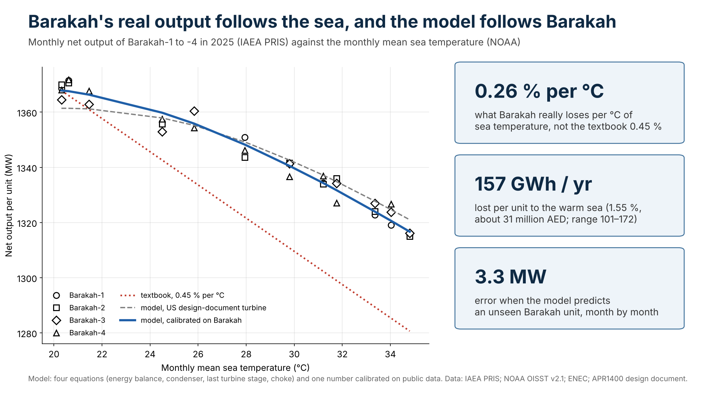

# The Cost of a Warm Gulf

**How much electricity does a nuclear plant lose because its cooling water is warm?**

A nuclear plant turns about a third of its heat into electricity and must dump the rest into a heat sink, here the sea. The colder the sea, the more power each kilogram of steam produces. The Persian Gulf is the world's hottest sea in summer (about 34 °C at Barakah in August) and it is warming by roughly 0.36 °C per decade.

This repository is a small, general model that answers that question for **any steam-cycle reactor at any Gulf site**, using only public data, and tests the answer against the real monthly output of operating plants.



## Main results

| Result | Value |
|---|---|
| Loss per °C of sea temperature, Barakah (APR1400) | **0.26 % of output per °C**, against 0.45 % from a simple first-law model |
| Choke temperature T\* (APR1400): below it, colder water gives no extra power | **19.3 °C**. Barakah's sea is above it about 355 days a year |
| Fitted turbine exhaust area | **109.1 m²** (the US design document gives 96.8 m²) |
| Fit to the real monthly output of Barakah-1 to -4 (2025, IAEA PRIS) | **3.1 MW RMS** (36 unit-months) |
| Predicting a unit left out of the calibration | **3.3 MW RMS** |
| Bushehr-1 (VVER-1000) | **5.1 MW RMS** (5 months) |
| Annual loss to the warm sea, per Barakah unit | **about 157 GWh/yr** (1.55 %, range 101–172 GWh) |
| 95 % bootstrap interval for the exhaust area (calendar-month resampling) | **101–114 m²**, which puts the loss at 126–176 GWh/yr ([`extra_checks/`](extra_checks/)) |
| Cost of tightening the 5 °C discharge rule by 1 °C | **1.75–1.79 MW**, against ~49 MW lost to the warm sea on an average August day |

Further findings:
- **Why the simple model overstates the loss.** The simple first-law model (Durmayaz & Sogut, 2006) gives 0.45 % per °C. This model with the exhaust loss switched off gives 0.44 %. With the turbine of the US design document it gives 0.24 %, and Barakah's real output shows 0.26 %.
- **Location matters.** For the APR1400, the loss rises from 1.15 % at Az-Zour (Kuwait) to 1.55 % at Barakah, because the southern Gulf stays above T\* for more of the year. Fujairah, on the Gulf of Oman, is no better at 1.59 %.
- **Warming accelerates the loss.** +2 °C of warming raises Barakah's loss from 157 to about 208 GWh per unit per year. Beyond +2 °C, days above the plant's 38.5 °C shutdown limit start to appear.

The full write-up is in [`report/report.pdf`](report/report.pdf). Step-by-step derivations of the equations are in [`docs/derivations.md`](docs/derivations.md). The source of every number, formula and figure is in [`docs/Sources_and_Data.pdf`](docs/Sources_and_Data.pdf).

## How the model works

Only two parts of a power plant "see" the sea: the **condenser** and the **end of the low-pressure turbine**. Everything upstream works at pressures about 150 times higher and is unaffected (Stodola's ellipse law). So the model describes the rest of the plant only by the steam it delivers.

```
 sea temperature ──► condenser ──► last turbine stage ──► electrical output
   (site card)        (eq. 2)         (eqs. 3–4)              │
        ▲                                                     │
        └──────────── heat to reject (eq. 1) ◄────────────────┘
```

It has four equations:

1. **Energy balance.** The heat the condenser must reject is the reactor's heat minus the electricity produced.
2. **Condenser** (effectiveness–NTU). At a given seawater flow, the condenser sits a fixed number of degrees above the sea.
3. **Last turbine stage.** A warmer condenser means a higher exhaust pressure, so each kilogram of steam does less work.
4. **Choke.** Below a certain pressure, the steam leaves the turbine so fast that its wasted kinetic energy cancels the extra expansion work. Colder water then gives nothing more. The sea temperature where this happens is **T\***.

From these, the model derives a **closed-form exhaust-choke law** for the loss per °C. In one line:

> loss per °C = (simple first-law value) × (1 − M²)

Here M is 0 when the steam's exit speed is ignored and 1 at the choke. So the simple first-law value is an upper bound, and real turbines always lose less per degree.

There are three inputs:
- **Reactor card.** About a dozen public numbers per reactor (thermal power, reference output, condenser design, turbine efficiency and so on), each with its source, in [`data/reactors.yaml`](data/reactors.yaml). Three reactor types are included: APR1400, VVER-1000 and a NuScale-type SMR.
- **Site card.** Daily sea-surface temperature from NOAA OISST v2.1 (1982–2025) for seven sites, in [`data/sites.yaml`](data/sites.yaml) and [`data/sst/`](data/sst/).
- **One calibrated number.** The turbine's effective exhaust area is fitted to the reactor's public monthly output from IAEA PRIS ([`data/reference/pris_2025_monthly.csv`](data/reference/pris_2025_monthly.csv)). Everything else comes straight from public documents.

On top of the physics sits a **cost function** with one daily decision, the cooling-water flow. It prices the 5 °C discharge rule.

## Experiments

| | Experiment | Output |
|---|---|---|
| E1 | Validation on the real output of Barakah-1 to -4 and Bushehr-1 | `results/fig_e1_validation.png` |
| E2 | Sensitivity of three reactor types | `results/fig_e2_sensitivity.png` |
| E3 | Losses at seven Gulf sites | `results/fig_e3_siting.png` |
| E4 | A warming Gulf | `results/fig_e4_climate.png` |
| E5 | Daily cooling-flow decision and the price of the 5 °C rule | `results/fig_e5_operation.png` |
| E6 | Robustness to every assumed input | `results/fig_e6_robustness.png` |

## Run it

You need Python 3.10 or newer. The run takes about a minute and needs no internet.

```bash
git clone https://github.com/kira8587-git/gulf-reactor-cooling.git
cd gulf-reactor-cooling
python -m pip install -r requirements.txt
python run_all.py
```

On Windows, run `python -m venv .venv` and then `.venv\Scripts\activate` before the `pip install`.

`run_all.py` runs the test suite first and then experiments E1–E6. It writes the figures, tables and `summary.json` to `results/`.

- **Rebuild the report:** `python report/build_report.py`. This always writes `report/report.md`. The PDF step also needs pandoc and Node.js with Playwright. For the same equation rendering as the published PDF, put MathJax 3's `tex-svg.js` in `report/vendor/`. Without it, pandoc falls back to MathML.
- **Extra checks:** `python extra_checks/fit_uncertainty.py` (about 30 s) and `python extra_checks/cost_by_month.py`.
- **Rebuild the key figure:** `python report/make_key_slide.py`, which writes `docs/key_slide.png`.

## Repository layout

| Path | What |
|---|---|
| `model/plant.py` | the four equations (condenser, last stage, choke, closure) |
| `model/law.py` | the closed-form exhaust-choke law |
| `model/calibrate.py` | the one calibration: exhaust area from PRIS monthly output, or from a design heat balance |
| `model/annual.py` | annual loss and days above T\* |
| `model/operate.py` | cost function, daily optimal cooling flow, shadow price of the discharge rule |
| `model/props.py`, `model/sea.py`, `model/cards.py` | steam (IAPWS-IF97) and seawater properties, sea data, reading the cards |
| `experiments.py` | experiments E1–E6 |
| `tests/test_model.py` | tests, run by `run_all.py` |
| `data/` | reactor and site cards, sea temperatures, reference data (PRIS 2025 monthly output, APR1400 design heat balance, KNS 2015 condenser table) |
| `results/` | figures, tables and `summary.json` from the last run |
| `extra_checks/` | checks added after the report: bootstrap uncertainty of the fit, and the yearly loss split by month |
| `report/` | report template, build script and the finished report |
| `docs/` | derivations of the equations, sources and data (PDF and CSV registers), bibliography, key figure |

## Add a reactor or a site

- **Reactor:** add a card to `data/reactors.yaml` with thermal power, reference output and condenser pressure, LP inlet state, LP efficiency, exhaust area, condenser design rise and gap, and load factor. Each value needs a source. Leave the exhaust flow `null` to compute it from the energy balance. Leave the exhaust area `null` to calibrate it on the reactor's PRIS monthly output, after adding the rows to `data/reference/pris_2025_monthly.csv`.
- **Site:** add it to `data/sites.yaml` and run `python data/download_sst.py <name> <lat> <lon>`.

## Known limitations

- **One year of data.** The calibration uses 2025 only, which is 12 distinct months, and the four units share them, so the points are not independent.
- **Satellite sea temperature.** The model uses satellite sea-surface temperature, not the plant's measured intake temperature.
- **The choke is not seen directly.** The coldest month in the data is 20.3 °C, just above T\*.
- **Summer "external" losses.** PRIS counts some summer losses as external. They are treated as heat-related here. If they are grid losses instead, the answer drops to 101 GWh per unit per year.
- **Condenser heat-transfer coefficient** is held constant at its design value.
- **The SMR card is not calibrated**, because no operating output data exists for it.

## Status and next steps

This is an active project. Planned extensions include more years of PRIS monthly data, the cause codes of the summer "external" losses, plant intake-temperature records, and climate-model projections in place of uniform warming.

## Author

Shaunak Thakur

**AI-use disclosure.** Claude (Anthropic) was used to help write the code, process the data and draft the report and documentation. All modelling choices, equations, data and conclusions were checked by the author.

If you use this work, please cite it (see [`CITATION.cff`](CITATION.cff)).

## License

- **Code:** MIT, see [LICENSE](LICENSE).
- **Report and figures** (`report/`, `results/*.png`, `docs/key_slide.*`, `docs/Sources_and_Data.pdf`): [CC BY 4.0](https://creativecommons.org/licenses/by/4.0/), see [LICENSE-REPORT.md](LICENSE-REPORT.md).
- **Data** stays under its sources' terms: NOAA OISST is public domain, and IAEA PRIS data is under the IAEA's own terms. See [`docs/source_register.csv`](docs/source_register.csv) for each source.
