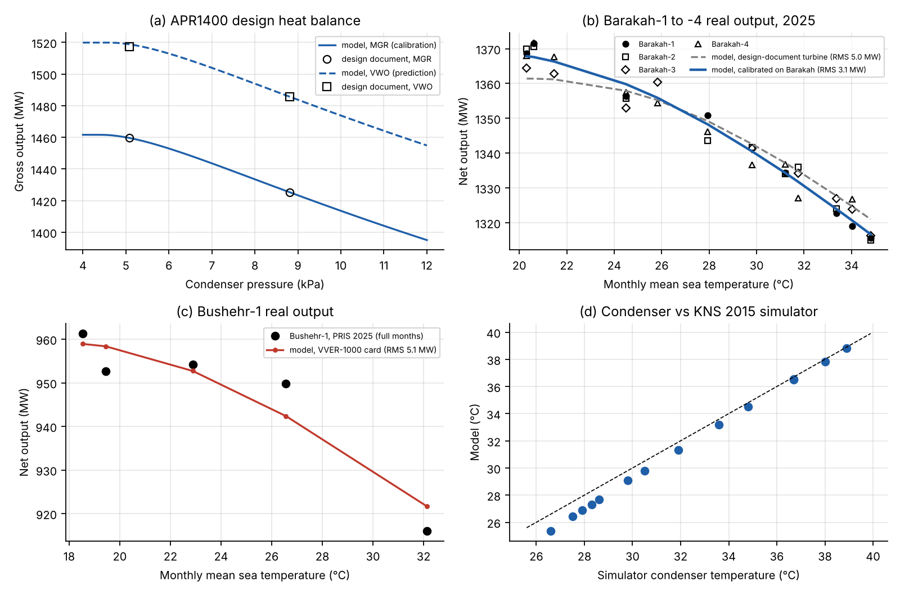
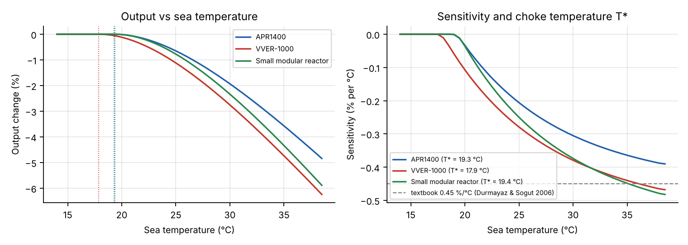
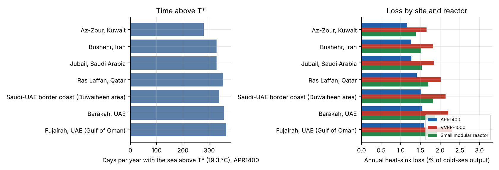
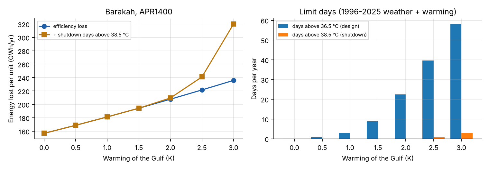
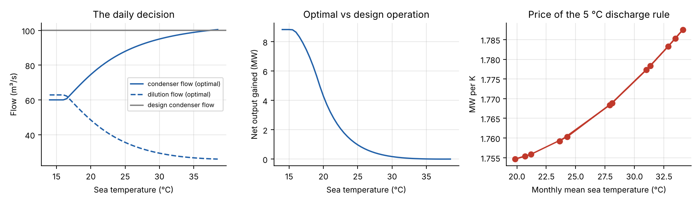
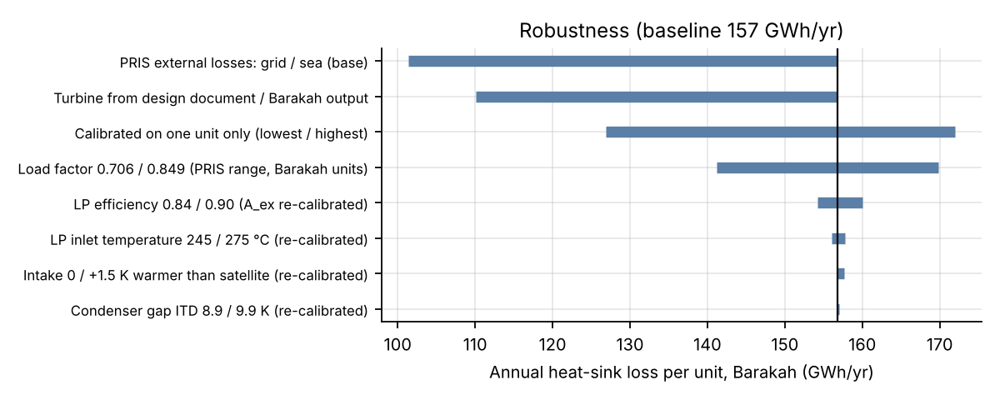

::: cover
<div class="title">The Cost of a Warm Gulf</div>
<div class="subtitle">A simple, general model of heat-sink losses for nuclear reactors in the Gulf</div>
<div class="meta">Shaunak Thakur · 2026<br>Report, code and data: <code>github.com/kira8587-git/gulf-reactor-cooling</code> (run <code>python run_all.py</code>)</div>
<div class="note"><b>Abstract.</b> Nuclear plants in the Gulf reject about two-thirds of their heat into the world's hottest sea. We build a model that applies to <b>any</b> steam-cycle reactor at <b>any</b> Gulf site. A reactor is described by about a dozen public numbers, a site by its daily sea temperature, and the physics by four equations. One number, the turbine's effective exhaust area, is calibrated on the reactors' public monthly output (IAEA PRIS).<br><br>
Results:
<ol>
<li>A closed-form <b>exhaust-choke law</b>, derived from standard thermodynamics. It explains why Barakah's units lose about 0.26 % of output per °C (2025), not the textbook 0.45 %, and why colder water gives nothing below a <b>choke temperature T*</b> (about 18–19 °C).</li>
<li>Validation on <b>real output</b>: the model reproduces the monthly output of Barakah's four units to 3.1 MW (RMS); calibrated on three units it predicts the fourth to 3.3 MW. Bushehr-1 matches to 5.1 MW.</li>
<li>Barakah loses about <b>157 GWh per unit per year</b> (1.55 %, range 101–172 GWh). Losses rise from the north of the Gulf to the south, and faster with every degree of warming.</li>
<li>A <b>cost function</b> with one daily decision (cooling-water flow). It prices the 5 °C discharge rule at only 1.75–1.79 MW per °C, small next to the warm sea itself.</li>
</ol></div>
:::

# 1. Introduction {.first}

**The problem.** A nuclear plant turns about a third of its heat into electricity and rejects the rest to a heat sink, here the sea. The colder the sink, the lower the turbine's exhaust pressure and the more power each kilogram of steam produces. Each summer the Gulf is the world's hottest sea (Paparella et al., 2019). At Barakah it averages 34.4 °C in August and is warming by about 0.36 °C per decade (section 4).

**Why it matters.**
- **Barakah:** the UAE's four APR1400 units supply about a quarter of the country's electricity (WNA, 2026).
- **More reactors:** Saudi Arabia plans nuclear power, with a licensed site at Duwaiheen near the UAE border (WNA, 2026), and Bushehr (Iran) uses the same sea.
- **Timing:** the sea is warmest in summer, when electricity demand also peaks.

**What is usually done.** Studies use about 0.45 % of output lost per °C of cooling water (Durmayaz & Sogut, 2006); plant data in Europe give a similar 0.5 % per °C of air temperature (Linnerud et al., 2011). ENEC states that studies found the effect of the Gulf's warm water to be "negligible" (ENEC FAQ). Neither view gives a number for the Gulf that can be checked against real output.

**What we do.** We build the simplest model that still contains the right physics, keep it general, and test it on real plant output.

| | |
|---|---|
| **Reactor** | about a dozen public numbers (the "reactor card") |
| **Site** | the daily sea temperature from NOAA satellites (the "site card") |
| **Physics** | four equations: energy balance, condenser, last turbine stage, choke |
| **Calibration** | one number, the turbine's effective exhaust area, from the reactor's public monthly output |

**Contributions:**
1. **The exhaust-choke law:** we derive a closed-form sensitivity for any reactor. The turbine's exhaust (leaving) loss itself is well known in turbine engineering (Spencer, Cotton & Cannon, 1963). What is new is linking it in closed form to the sea temperature, which recovers the textbook value as a limiting case and defines the choke temperature T* (section 3.1).
2. **Calibration and validation on public operating data** (IAEA PRIS), which works for any operating Gulf reactor, tested on all four Barakah units and on Bushehr-1 (sections 2.5 and 5).
3. **Gulf-wide results:** what the warm sea costs at seven sites for three reactor types, and how the cost grows with warming (section 6).
4. **A cost function with one decision:** daily cooling-water flow, and the price of the 5 °C discharge rule (section 3.2).

**How to read this report.** Section 2 builds the model, section 3 derives what it implies, section 5 tests it against real plant output, section 6 gives the results and section 7 says how far to trust them. A list of symbols is in section 2.3 and a glossary is at the end.

# 2. The model

::: key
**The whole model in plain words.**

1. The reactor makes heat. About a third becomes electricity, and the rest must go into the sea (eq. 1).
2. At a given cooling-water flow, the condenser is a fixed number of degrees warmer than the sea (eq. 2).
3. A warmer condenser means a higher pressure at the turbine's exit, so each kilogram of steam does less work (eq. 3).
4. A colder condenser helps only down to a point. Below it, the steam leaves so fast that the wasted kinetic energy cancels the gain (eq. 4).

Everything else in this report follows from these four statements and one fitted number.
:::

## 2.1 The idea

```{=html}
<svg width="100%" viewBox="0 0 760 210" xmlns="http://www.w3.org/2000/svg" font-family="DejaVu Sans, Arial, sans-serif" font-size="11">
<defs><marker id="ar" viewBox="0 0 10 10" refX="9" refY="5" markerWidth="7" markerHeight="7" orient="auto-start-reverse"><path d="M0,0 L10,5 L0,10 z" fill="#333"/></marker></defs>
<rect x="10" y="40" width="150" height="80" rx="6" fill="#e6f2ea" stroke="#2e7d32"/>
<text x="85" y="66" text-anchor="middle" font-weight="bold">SEA (site card)</text>
<text x="85" y="84" text-anchor="middle">daily temperature T_s</text><text x="85" y="100" text-anchor="middle">NOAA, 1982–2025</text>
<rect x="200" y="40" width="160" height="80" rx="6" fill="#eef4f9" stroke="#0f2a44"/>
<text x="280" y="66" text-anchor="middle" font-weight="bold">CONDENSER (eq. 2)</text>
<text x="280" y="84" text-anchor="middle">T_c = T_s + rise / ε</text><text x="280" y="100" text-anchor="middle">→ exhaust pressure p_c</text>
<rect x="400" y="40" width="170" height="80" rx="6" fill="#eef4f9" stroke="#0f2a44"/>
<text x="485" y="66" text-anchor="middle" font-weight="bold">LAST TURBINE STAGE</text>
<text x="485" y="84" text-anchor="middle">(eqs. 3–4) output P(p_c)</text><text x="485" y="100" text-anchor="middle">choke below T*</text>
<rect x="610" y="40" width="140" height="80" rx="6" fill="#f3eefa" stroke="#5b3a8c"/>
<text x="680" y="66" text-anchor="middle" font-weight="bold">COST (eq. 8)</text>
<text x="680" y="84" text-anchor="middle">J = price × loss</text><text x="680" y="100" text-anchor="middle">decision: cooling flow</text>
<g stroke="#333" stroke-width="1.4" fill="none">
<line x1="160" y1="80" x2="198" y2="80" marker-end="url(#ar)"/><line x1="360" y1="80" x2="398" y2="80" marker-end="url(#ar)"/>
<line x1="570" y1="80" x2="608" y2="80" marker-end="url(#ar)"/>
<path d="M485,120 L485,160 L280,160 L280,122" marker-end="url(#ar)"/>
<path d="M680,40 L680,18 L280,18 L280,38" marker-end="url(#ar)" stroke-dasharray="4 3"/>
</g>
<text x="382" y="176" text-anchor="middle" font-size="10">heat to reject: Q_c = Q_th − P/η_g (eq. 1)</text>
<text x="480" y="13" text-anchor="middle" font-size="10">decision: cooling-water flow V_w</text>
</svg>
```
<p class="small" style="text-align:center">Figure 1. The model. The sea sets the condenser temperature. The condenser temperature sets the exhaust pressure of the last turbine stage, which sets the output. The rest of the reactor and turbine does not feel the sea.</p>

Only two parts of a power plant "see" the sea: the **condenser** and the **end of the low-pressure turbine**. The reactor, steam generator, high-pressure turbine and reheaters work at much higher pressures. The low-pressure turbine inlet is at about 150 times the condenser pressure, so by Stodola's ellipse law (Cooke, 1985) a change in condenser pressure from 4 to 12 kPa changes the steam flow by less than 0.004 %. We therefore model only those two parts, and describe the rest by the steam it delivers.

## 2.2 Assumptions

| # | Assumption | Why it is reasonable |
|---|---|---|
| A1 | Steady state each day | Turbine and condenser settle in minutes; the sea changes over days |
| A2 | Upstream cycle and exhaust steam flow unaffected by the condenser | Stodola's ellipse law (above). We neglect the small change in the steam drawn by the lowest feedwater heater (an earlier, detailed version of our model put it at 5–10 % of the summer sensitivity) |
| A3 | Last stage has a constant isentropic efficiency $\eta_\mathrm{LP}$ | Standard turbine representation |
| A4 | Condenser conductance UA fixed at its design value; when the flow changes (section 3.2), UA scales with flow$^{0.4}$ | Assumption: the water side is about half of the resistance, and its coefficient grows as flow$^{0.8}$ (Dittus–Boelter) |
| A5 | Exhaust kinetic energy $V^2/2$ is lost | The turbine "exhaust (leaving) loss" (Spencer, Cotton & Cannon, 1963) |
| A6 | Steam properties from IAPWS-IF97 (Wagner et al., 2000); seawater from Sharqawy et al. (2010) | International standards |

## 2.3 The four equations

**Symbols used:**

| Symbol | Meaning | Symbol | Meaning |
|---|---|---|---|
| $T_s$ | sea temperature | $P$ | gross electrical output |
| $T_c$ | condenser (steam) temperature | $\dot Q_\mathrm{th}$, $\dot Q_c$ | heat into the cycle; heat rejected to the sea |
| $p_c$ | condenser pressure, set by $T_c$ | $\dot m$ | seawater flow through the condenser |
| $p_e$ | pressure at the turbine exhaust | $\dot m_\mathrm{ex}$ | steam flow leaving the last turbine stage |
| $p^*$, $T^*$ | choke pressure; the sea temperature that gives it | $A_\mathrm{ex}$ | effective exhaust area of the turbine |
| $V$ | speed of the steam leaving the turbine | $\eta_g$, $\eta_\mathrm{LP}$ | generator and low-pressure turbine efficiency |
| $g$ | energy per kg of steam not turned into work | $\varepsilon$ | condenser effectiveness (0 to 1) |

::: fig
**Heat to reject** (energy balance): what the reactor delivers, minus what leaves as electricity.

::: eq
$$\dot Q_c = \dot Q_{\mathrm{th}} - \frac{P}{\eta_g}$$
[(1)]{.eqn}
:::
:::

**Condenser** (effectiveness–NTU). The seawater, flowing at $\dot m$, warms by $\Delta T_w = \dot Q_c/(\dot m c_p)$; the condenser sits above the sea by $\Delta T_w/\varepsilon$:

::: eq
$$T_c = T_s + \frac{\dot Q_c}{\varepsilon\,\dot m\,c_p}, \qquad \varepsilon = 1 - e^{-UA/(\dot m c_p)}$$
[(2)]{.eqn}
:::

**Last turbine stage.** Steam expands from the LP inlet state to the exhaust pressure $p_e$. What it has not turned into work is $g$ per kg: its enthalpy $h_e$ plus the kinetic energy it carries out of the turbine.

::: eq
$$P = P_{\mathrm{ref}} - \eta_g\,\dot m_{\mathrm{ex}}\,\big[\,g(p_e) - g(p_{\mathrm{ref}})\,\big]$$
[(3)]{.eqn}
:::

::: eq
$$g(p) = h_e(p) + \frac{V(p)^2}{2}, \qquad V(p) = \frac{\dot m_{\mathrm{ex}}\,v_e(p)}{A_{\mathrm{ex}}}, \qquad h_e(p) = h_{\mathrm{in}} - \eta_{\mathrm{LP}}\big[h_{\mathrm{in}} - h(p, s_{\mathrm{in}})\big]$$
[ ]{.eqn}
:::

Here $h(p, s_\mathrm{in})$ is the enthalpy after an ideal (isentropic) expansion and $v_e$ is the steam's specific volume at the exhaust.

**Choke.** Colder water cannot push the exhaust below the pressure $p^*$ where $g$ is smallest:

::: eq
$$p_e = \max\left(p_c,\ p^*\right), \qquad p^* = \mathop{\mathrm{arg\,min}}_{p}\ g(p)$$
[(4)]{.eqn}
:::

**Solving.** Equations (1)–(2) are solved together by simple iteration, which converges in at most 5 steps. Equation (4) captures the key physics: at low pressure the steam's volume, and hence its exit speed, grows so fast that the extra kinetic-energy loss cancels the extra expansion work.

::: key
**Worked example: Barakah at its design point.** Heat to reject (eq. 1): 4,000 − 1,425.3 / 0.985 = 2,553 MW, about 64 % of the reactor's heat. Seawater at 100 m³/s carries it away and warms by 6.26 K. The condenser sits 9.4 K above the sea (eq. 2), so a sea 1 °C warmer gives a condenser 1 °C warmer.
:::

## 2.4 Inputs: a reactor card and a site card

**Reactor card** (`data/reactors.yaml`; every number has its source):

| Symbol | Meaning | APR1400 (Barakah) | VVER-1000 (Bushehr) | SMR |
|---|---|---|---|---|
| $\dot Q_\mathrm{th}$ | heat into the steam cycle (MW) | 4,000 | 3,000 | 250 |
| $P_\mathrm{ref}$ | gross output at the reference pressure (MW) | 1,425.3 | 1,000.0 | 77.0 |
| $p_\mathrm{ref}$ | reference condenser pressure (kPa) | 8.80 | 8.80 | 8.80 |
| $\dot m_\mathrm{ex}$ | LP exhaust steam flow (kg/s) | 1,176 | 956 (rule) | 86 (rule) |
| $p_\mathrm{in}, T_\mathrm{in}$ | LP turbine inlet (kPa, °C) | 1,333, 260 | 1,150, 250 | 3,300, 290 |
| $\eta_\mathrm{LP}$, $\eta_g$ | LP and generator efficiency | 0.87, 0.985 | 0.87, 0.985 | 0.85, 0.975 |
| $A_\mathrm{ex}$ | effective exhaust area (m²) | 109.1 (calibrated, Barakah-1 to -4) | 96.2 (calibrated, Bushehr-1) | 8.0 (assumed) |
| $\Delta T_w$, ITD | condenser design: water rise, condenser–sea gap (K) | 6.26, 9.4 | 6.26, 9.4 | 6.26, 9.4 |
| LF | load factor | 0.784 | 0.602 | 0.900 |

**Condenser design from two numbers.** The design water rise $\Delta T_w$ gives the flow, $\dot V = \dot Q_c/(\rho c_p\Delta T_w)$, and the design gap between condenser and sea (ITD) gives the effectiveness, $\varepsilon = \Delta T_w/\mathrm{ITD}$. For Barakah, ENEC states that 6,000 m³ of seawater per minute (100 m³/s) pass through each condenser (ENEC, 2017), so $\Delta T_w$ = 6.26 K. The gap of 9.4 K is the August design point of the Barakah condenser in the KNS simulator study (Abdoelatef et al., 2015).

**Exhaust flow from the energy balance** when no heat balance is published: $\dot m_\mathrm{ex} = \dot Q_c/(x_e h_{fg})$. For the APR1400 this gives 1,234 kg/s against the published 1,176 kg/s.

**Site card** (`data/sites.yaml`): location, salinity and the daily sea temperature (NOAA OISST v2.1, 1982–2025). One set of rules and prices is used for all sites: the 5 °C discharge rule, Barakah's 36.5 °C design and 38.5 °C shutdown sea temperatures (Abdoelatef et al., 2015), 200 AED/MWh (scenario) and 0.40 t CO₂/MWh (gas replacement).

## 2.5 The one calibration: the exhaust area

The effective exhaust area $A_\mathrm{ex}$ decides how much of a colder sea the turbine can use, and it is rarely published. We take it from **real operation**. IAEA PRIS publishes each reactor's monthly output. In months when a unit was online all month, we add back the plant's own losses (PRIS "unit capability"), so what remains follows the sea. We then fit

::: eq
$$P_{\mathrm{obs}}(\mathrm{unit},\,\mathrm{month}) = \overline{P_{\mathrm{model}}(T_s,\,A_{\mathrm{ex}})}_{\,\mathrm{days\ of\ month}} - L_{\mathrm{unit}}$$
[(5)]{.eqn}
:::

for $A_\mathrm{ex}$ and one constant $L$ per unit (house load and rating), by least squares. For Barakah we use all four units (36 unit-months in 2025).

**PRIS "external" losses.** In summer PRIS books part of each Barakah unit's shortfall as an "external" loss, outside the plant's control. IAEA's outage coding lists "cooling water temperature limits" among such external causes, together with grid causes (IAEA, 2004). At all four units these losses appear only in the warm months (May to October) and never from November to April, so we count them as heat-sink losses. Counting them as grid losses instead fits the data clearly worse (RMS 5.8 against 3.1 MW) and gives a lower loss (section 7). The method needs only public data, so it works for any operating Gulf reactor. For the APR1400 we also calibrate on the US design document (its heat balance at two condenser pressures) as an independent check.

# 3. What the model shows

## 3.1 The exhaust-choke law and the choke temperature T*

Differentiating equation (3) uses only two exact facts: the Gibbs relation along the expansion ($\mathrm dh_e/\mathrm dp = \eta_\mathrm{LP}v_s$) and the Clausius–Clapeyron equation ($\mathrm dp/\mathrm dT = h_{fg}/(Tv_{fg})$) (Appendix B). It gives

::: theorem
::: eq
$$\frac{\mathrm{d}P}{\mathrm{d}T_c} = -\,\eta_g\,\eta_{\mathrm{LP}}\,\dot m_{\mathrm{ex}}\,\frac{v_s}{v_{fg}}\,\frac{h_{fg}}{T_c}\,\big(1-M^2\big), \qquad M^2 = \frac{V^2}{\eta_{\mathrm{LP}}\,\kappa\,p_c\,v_s}$$
[(6)]{.eqn}
:::

and, since $\dot m_\mathrm{ex}\,x_e h_{fg}\approx\dot Q_c$, the relative form

::: eq
$$\sigma = \frac{1}{P}\,\frac{\mathrm{d}P}{\mathrm{d}T_c} \approx -\,\eta_{\mathrm{LP}}\,\frac{x_s}{x_e}\,\frac{1-\eta}{\eta}\,\frac{1}{T_c}\,\big(1-M^2\big)$$
[(7)]{.eqn}
:::
:::

::: key
**In one line.** Loss per degree = (textbook value) × $(1 - M^2)$. $M$ is 0 when the steam's exit speed is ignored and 1 at the choke, so a real turbine always loses less per degree than the textbook value.
:::

**Reading it:**
- $\eta$ is the plant efficiency, and $\kappa = -\mathrm d\ln p/\mathrm d\ln v_e$ describes how fast the steam expands along the expansion line. $M$ plays the role of an exhaust "Mach number": it compares the kinetic-energy loss with the work gained as the pressure falls.
- **When $M \to 0$** (no exhaust loss), eq. (7) gives the textbook value: a loss of 0.47 % per °C for the APR1400. Every real turbine has $M > 0$, so **the textbook value is an upper bound**.
- **When $M = 1$** the sensitivity is zero. The condenser temperature where this happens, mapped back through the condenser, is the **choke temperature T\***: colder seawater gives no extra power.
- **Less efficient reactors** (smaller $\eta$) are more sensitive, through $(1-\eta)/\eta$.

::: fig
**Where the textbook number comes from**:

| Source | Output change per °C |
|---|---|
| Textbook heat-balance model; exhaust kinetic energy neglected (Durmayaz & Sogut, 2006) | 0.45 % |
| Our model with the exhaust loss switched off (APR1400, 2.6 → 1.5 inHgA) | 0.44 % |
| APR1400 design document, same change of condenser pressure | 0.24 % |
| Barakah-1 to -4 real output, 2025 (IAEA PRIS), per °C of sea temperature | 0.26 % |

<p class="small">Per °C of cooling water (rows 1 and 4) or of condenser temperature (rows 2 and 3); at fixed flow the two move together.</p>
:::

The textbook value is what our model gives without the exhaust loss. Real turbines, as in the design document and Barakah's real output, give about half to two-thirds of it. Eq. (6) agrees with the numerical derivative of the model to within 0.0053 % (test `test_law_equals_numerical_derivative`).

## 3.2 The cost function and the daily decision

::: eq
$$J = 24 \sum_{\mathrm{days}} \pi\,\big[P_{\mathrm{best}} - P_{\mathrm{net}}(u)\big]$$
[(8)]{.eqn}
:::

$\pi$ is the value of electricity (AED/MWh). The plant has one daily decision: the condenser cooling flow $u = \dot V_w$. More flow cools the condenser but costs pumping power. Extra seawater $\dot V_b$ that bypasses the condenser dilutes the warm outflow to meet the 5 °C rule. Each day the plant chooses

::: eq
$$\max_{\dot V_w}\ P_{\mathrm{net}} = P\big(T_c(\dot V_w)\big) - \frac{\rho g}{\eta_p}\Big[\dot V_w\Big(H_s + H_f\Big(\frac{\dot V_w}{\dot V_{\mathrm{des}}}\Big)^{2}\Big) + \dot V_b H_b\Big]$$
[(9)]{.eqn}
:::

subject to three limits: the 5 °C rule, a minimum condenser flow and the intake capacity,

::: eq
$$\frac{\dot Q_c}{\rho\,c_p\,(\dot V_w+\dot V_b)} \le 5\ \mathrm{K}, \qquad \dot V_w \ge 0.6\,\dot V_{\mathrm{des}}, \qquad \dot V_w + \dot V_b \le 1.5\,\dot V_{\mathrm{des}}$$
[ ]{.eqn}
:::

There is one variable on an interval, so an optimum exists and a bounded search finds it. The **shadow price** of the discharge rule, $\lambda = \partial P^*_\mathrm{net}/\partial\Delta T_\mathrm{max}$, is the MW the rule costs per °C.

::: key
**The 5 °C discharge rule.** Barakah's cooling water may return to the sea at most 5 °C warmer than the surrounding Gulf. This is a FANR regulation, as stated by ENEC (2017), which also says the plant mixes intake seawater into its cooling water to reduce the effect of the warm discharge. With 100 m³/s through the condenser the water warms by about 6.3 °C, so at design about 24 m³/s of dilution water is needed. The pump heads and the intake limit used here are our assumptions (`data/sites.yaml`).
:::

# 4. Data

| Data | Source | Used for |
|---|---|---|
| Monthly output 2025, Barakah-1 to -4 and Bushehr-1 | IAEA PRIS reactor pages | calibration and validation; load factors |
| APR1400 heat balance at 2.6 and 1.5 inHgA, two loads | APR1400 Design Control Document, Ch. 10 (US NRC ML18228A657) | APR1400 card; cross-check |
| Barakah condenser design, 14 operating points | KNS simulator study, run with El-Dabaa (Egypt) sea temperatures (Abdoelatef et al., 2015) | condenser design gap; check |
| Condenser seawater flow, 5 °C rule | ENEC press release (2017) | condenser design; decision model |
| Daily sea temperature, 7 sites, 1982–2025 | NOAA OISST v2.1 (Huang et al., 2021) | site cards |
| SMR module data | NuScale Power Module specifications (2026) | SMR card |

**Gaps:** 1,194 days per site (mostly 1992–1998) are missing from NOAA's server copy. They are filled with the 1991–2020 mean for that day plus the interpolated departure, and flagged. Results use 1996–2025.

**Sea climate of the sites:**

| Site | Mean (°C) | August mean (°C) | Hottest day (°C) | Trend (°C/decade) |
|---|---|---|---|---|
| Az-Zour, Kuwait | 25.3 | 33.0 | 35.3 | +0.49 |
| Bushehr, Iran | 26.4 | 33.7 | 36.1 | +0.46 |
| Jubail, Saudi Arabia | 26.4 | 33.4 | 35.8 | +0.42 |
| Ras Laffan, Qatar | 27.1 | 33.9 | 36.3 | +0.36 |
| Saudi-UAE border coast (Duwaiheen area) | 27.3 | 34.5 | 36.8 | +0.34 |
| Barakah, UAE | 27.7 | 34.4 | 36.7 | +0.36 |
| Fujairah, UAE (Gulf of Oman) | 28.4 | 32.2 | 35.1 | +0.23 |

# 5. Validation

::: fig

<p class="small" style="text-align:center">Figure 2. (a) APR1400 output against condenser pressure, model vs design heat balance. (b) Monthly net output of Barakah-1 to -4 in 2025 against sea temperature, real (IAEA PRIS; each unit's constant offset removed) and model. (c) The same for Bushehr-1. (d) Condenser temperature, model vs KNS simulator.</p>
:::

| Check | Result |
|---|---|
| **Barakah-1 to -4 real output** (PRIS 2025, 36 unit-months online all month; output varies by 57 MW) | **Prediction** with the design-document turbine (only $L$ fitted): RMS error 5.0 MW. **Calibrated** on all four units ($A_\mathrm{ex}$ = 109.1 m²): RMS error 3.1 MW. **Out of sample:** calibrated on three units, the model predicts the fourth to 3.3 MW (RMS). Calibrated on single units: $A_\mathrm{ex}$ = 101–113 m² |
| **Bushehr-1 real output** (PRIS 2025, 5 months; output varies by 45 MW) | VVER-1000 card calibrated ($A_\mathrm{ex}$ = 96.2 m²): RMS error 5.1 MW |
| **Design heat balance** (US APR1400): calibrate on the gain from 2.6 to 1.5 inHgA at full load, 34.3 MW | $A_\mathrm{ex}$ = 96.8 m². Then **predict** the same gain at valves-wide-open, where the exhaust flow is 4 % higher: model 33.1 MW vs 31.7 MW (error 1.3 MW) |
| **Condenser** vs the KNS simulator (design point = August row; 13 other rows predicted) | RMS error 0.72 K; below 0.3 K above 25 °C; largest 1.24 K in cold water, where the turbine is choked and output is unaffected |
| **Law (eq. 6)** vs numerical derivative | Differs by at most 0.0053 % |

**What the real output tells us.** Without seeing any Barakah data, the design-document turbine already predicts the four units' monthly output to 5.0 MW. But it underestimates the summer drop (0.20 % per °C against the real 0.26 %). Calibrated on Barakah's own output, the effective exhaust area is 13 % larger than the design document's. This is consistent with Barakah's slower 50 Hz turbine (1,500 rpm; PRIS) compared with the US 60 Hz design (1,800 rpm), since a slower turbine can carry longer last-stage blades. We use the Barakah calibration for all results.

# 6. Results

## 6.1 Three reactor types: the textbook value overstates the loss

::: fig

<p class="small" style="text-align:center">Figure 3. Output change and sensitivity against sea temperature for the three reactor types, with a Barakah-type condenser. Dotted lines mark T*.</p>
:::

| | APR1400 | VVER-1000 | SMR |
|---|---|---|---|
| Plant efficiency at 30 °C sea | 36.1 % | 33.9 % | 31.3 % |
| Choke temperature T* (sea) | 19.3 °C | 17.9 °C | 19.4 °C |
| Sensitivity at 30 °C | −0.31 %/°C | −0.38 %/°C | −0.37 %/°C |
| Sensitivity at 35 °C | −0.36 %/°C | −0.44 %/°C | −0.45 %/°C |
| No-exhaust-loss limit, eq. (6) with M = 0 | −0.47 %/°C | −0.52 %/°C | −0.57 %/°C |
| Exhaust velocity at the reference pressure | 154 m/s | 142 m/s | 148 m/s |

- **Below T\*** (18–19 °C, the Gulf's winter) colder water gives no extra power.
- **In summer** (30–35 °C) the sensitivity is −0.31 to −0.45 %/°C: below the textbook value, as eq. (7) predicts.
- **The APR1400 is the least sensitive** because it has the highest efficiency.

## 6.2 Where in the Gulf? Time above T*

::: fig

<p class="small" style="text-align:center">Figure 4. Left: days per year with the sea above the APR1400's T*. Right: annual loss for each reactor at each site (1996–2025 daily data).</p>
:::

| Site | Days above T* (APR1400) | APR1400 loss (GWh/yr per unit) | APR1400 (%) | VVER-1000 (%) | SMR (%) |
|---|---|---|---|---|---|
| Az-Zour, Kuwait | 280 | 116 | 1.15 | 1.65 | 1.38 |
| Bushehr, Iran | 328 | 127 | 1.26 | 1.82 | 1.52 |
| Jubail, Saudi Arabia | 328 | 128 | 1.27 | 1.84 | 1.53 |
| Ras Laffan, Qatar | 353 | 142 | 1.40 | 2.02 | 1.69 |
| Saudi-UAE border coast (Duwaiheen area) | 338 | 153 | 1.51 | 2.14 | 1.82 |
| Barakah, UAE | 355 | 157 | 1.55 | 2.21 | 1.87 |
| Fujairah, UAE (Gulf of Oman) | 365 | 161 | 1.59 | 2.30 | 1.92 |

- **Losses rise from the north of the Gulf to the south:** Az-Zour 1.15 % → Bushehr 1.26 % → Jubail 1.27 % → Ras Laffan 1.40 % → Saudi-UAE border coast 1.51 % → Barakah 1.55 % (APR1400). Northern sites have cooler winters, with more days below T\* and smaller excesses above it.
- **The Gulf of Oman loses slightly more than Barakah**, despite its cooler summers (August 32.2 °C against 34.4 °C): its sea is above T\* all year. **What matters is how long, and by how much, the sea stays above T\*, not the hottest day.**

## 6.3 A warming Gulf: losses accelerate

::: fig

<p class="small" style="text-align:center">Figure 5. Barakah, one APR1400 unit, 1996–2025 weather with uniform warming.</p>
:::

| Warming (K) | Efficiency loss (GWh/yr) | Days above 36.5 °C | Days above 38.5 °C (shutdown) | Total loss incl. shutdown (GWh/yr) |
|---|---|---|---|---|
| +0.0 | 157 | 0.1 | 0.0 | 157 |
| +0.5 | 169 | 0.7 | 0.0 | 169 |
| +1.0 | 181 | 3.0 | 0.0 | 181 |
| +1.5 | 194 | 8.8 | 0.0 | 194 |
| +2.0 | 208 | 22.5 | 0.1 | 210 |
| +2.5 | 222 | 39.6 | 0.7 | 241 |
| +3.0 | 236 | 58.0 | 3.0 | 320 |

- **Each degree costs more than the last** (convex): more days rise above T\*, and each day's loss grows faster than linearly.
- **Beyond about +2 K**, days above the 38.5 °C shutdown limit appear, and they soon dominate the cost.

## 6.4 The daily decision and the price of the 5 °C rule

::: fig

<p class="small" style="text-align:center">Figure 6. Barakah APR1400: optimal condenser and dilution flows, the gain over design operation, and the shadow price of the discharge rule.</p>
:::

- **In cool water the turbine is choked, so extra cooling is useless.** The best policy cuts the condenser flow and meets the 5 °C rule with cheaper dilution water. This gains about 4.3 MW at 20 °C and nothing in summer, about **8 GWh per unit per year**.
- **The 5 °C rule is cheap.** Tightening it by 1 °C costs 1.75–1.79 MW, mostly extra pumping of dilution water (about 2.4 million AED per unit per year). The warm sea itself costs about 49 MW on an average August day. So the rule can protect the sea at little cost; it is the sea temperature, not the rule, that costs Barakah power.

# 7. How robust are the results?

::: fig

<p class="small" style="text-align:center">Figure 7. Annual loss of one Barakah unit when one input is changed at a time. The vertical line is our best estimate (157 GWh/yr).</p>
:::

- **The assumed details hardly matter.** The exhaust area is re-calibrated on Barakah's real output each time, so changing the assumed LP efficiency, LP inlet temperature or condenser gap, or making the intake 1.5 °C warmer than the satellite reading, moves the annual loss by at most 2.1 %.
- **Two things matter more:**
  - **How the turbine is calibrated.** Calibrating on one Barakah unit alone gives 127–172 GWh/yr; on the US design document, 110 GWh/yr; and if PRIS's summer "external" losses were grid losses rather than heat (section 2.5), 101 GWh/yr.
  - **The load factor.** The PRIS lifetime load factors of Barakah's units (70.6–84.9 %) give 141–170 GWh/yr.

So one Barakah unit loses between about 101 and 172 GWh a year to the warm sea, with 157 GWh as our best estimate.

**Limitations.**
- The calibration uses one year (2025) of monthly data; more years would narrow the range.
- The model uses satellite sea-surface temperature, not the plant's measured intake temperature, and a uniform warming rather than climate-model projections.
- No SMR operates in the Gulf, so the SMR results are not calibrated and show the trend for its class rather than for a specific plant.

# 8. Conclusions

1. **A simple model reproduces real plants.** A reactor described by about a dozen public numbers, and the sea by its daily temperature, is enough: four equations and one calibrated number reproduce the monthly output of Barakah's four units to 3.1 MW (RMS), and predict a unit left out of the calibration to 3.3 MW (section 5, Figure 2).
2. **Warm water costs less than the textbook says, and cold water has a limit.** Barakah's units lose 0.26 % of output per °C of sea temperature, not the textbook 0.45 %, because the turbine's exhaust loss grows as the condenser gets colder (eq. 6, section 3.1). Below a choke temperature T\* of about 18–19 °C, colder water gives no extra power.
3. **At Barakah the warm sea costs about 157 GWh per unit per year**, 1.55 % of the output a cold sea would allow and about 31 million AED, or about 125 million AED a year for all four units (section 6.2). The range is 101–172 GWh (section 7). This is small as a percentage, as ENEC says, but not small in money.
4. **Location matters.** Among seven Gulf sites the APR1400's loss rises from 1.15 % at Az-Zour (Kuwait) to 1.55 % at Barakah, because the southern Gulf stays above T\* for more of the year. The Gulf of Oman is no better than Barakah (section 6.2).
5. **A warming Gulf makes it worse, faster.** Each degree of warming costs more than the one before: +2 °C raises Barakah's loss by about 32 %, and beyond +2 °C days above the 38.5 °C shutdown limit appear (section 6.3).
6. **The 5 °C discharge rule is cheap to keep.** Tightening it by 1 °C costs only 1.75–1.79 MW, mostly pumping, against about 49 MW lost to the warm sea on an average August day (section 6.4).

**Next steps:** more years of PRIS monthly data; the cause codes of the summer "external" losses; Barakah's intake temperature records; climate-model projections instead of uniform warming.

# Glossary

| Term | Meaning |
|---|---|
| Heat sink | where a power plant rejects the heat it cannot turn into electricity; here, the sea |
| Condenser | the heat exchanger where exhaust steam turns back into water, cooled by seawater in tubes |
| Exhaust (leaving) loss | the kinetic energy of the steam leaving the last turbine stage, which is not turned into work |
| Choke temperature T* | the sea temperature below which colder water gives no extra output |
| Load factor | energy actually produced in a period, divided by what full power all the time would give |
| IAEA PRIS | the International Atomic Energy Agency's public database of reactor operating data |
| RMS error | root-mean-square difference between model and data: the typical size of the miss |
| Shadow price | how much the best achievable output changes when a limit is relaxed by one unit |
| ITD | initial temperature difference: the gap between condenser and incoming seawater |
| SMR | small modular reactor |

# References

Only the sources of data and of less common formulas are listed here. Every number in the project is traced to its source in `docs/Sources_and_Data.pdf`.

- Abdoelatef, M. G., Rezk, O. & Lee, Y. K. (2015). Simplified study for the proposed APR1400 condenser performance based on El-Dabaa site, Egypt, with respect to BNPP & Shin Kori NPP. *Trans. Korean Nuclear Society Autumn Meeting*, Gyeongju.
- Cooke, D. H. (1985). On prediction of off-design multistage turbine pressures by Stodola's ellipse. *J. Eng. Gas Turbines Power* 107, 596–606.
- Durmayaz, A. & Sogut, O. S. (2006). Influence of cooling water temperature on the efficiency of a pressurized-water reactor nuclear-power plant. *Int. J. Energy Research* 30, 799–810.
- ENEC (2017). Final condenser for the Barakah Nuclear Energy Plant safely and successfully installed. Press release, 7 February 2017. ENEC, Barakah plant FAQ no. 12 (accessed November 2026).
- Huang, B. et al. (2021). Improvements of the Daily Optimum Interpolation Sea Surface Temperature (DOISST) version 2.1. *J. Climate* 34, 2923–2939.
- IAEA (2004). International outage coding system for nuclear power plants. IAEA-TECDOC-1393, Vienna.
- IAEA Power Reactor Information System (PRIS): Barakah-1 to -4 and Bushehr-1 reactor pages, 2025 data (accessed November 2026).
- Ibrahim, H. D., Xue, P. & Eltahir, E. A. B. (2020). Multiple salinity equilibria and resilience of Persian/Arabian Gulf basin salinity to brine discharge. *Front. Mar. Sci.* 7, 573.
- KEPCO & KHNP (2018). APR1400 Design Control Document, Tier 2, Chapter 10, Rev. 3. US NRC ADAMS ML18228A657.
- Linnerud, K., Mideksa, T. K. & Eskeland, G. S. (2011). The impact of climate change on nuclear power supply. *The Energy Journal* 32(1), 149–168.
- NuScale Power (2026). The NuScale Power Module technical specifications.
- Paparella, F., Xu, C., Vaughan, G. O. & Burt, J. A. (2019). Coral bleaching in the Persian/Arabian Gulf is modulated by summer winds. *Front. Mar. Sci.* 6, 205.
- Sharqawy, M. H., Lienhard, J. H. & Zubair, S. M. (2010). Thermophysical properties of seawater: a review of existing correlations and data. *Desalination and Water Treatment* 16, 354–380.
- Spencer, R. C., Cotton, K. C. & Cannon, C. N. (1963). A method for predicting the performance of steam turbine-generators: 16,500 kW and larger. *J. Eng. Power* 85, 249–298.
- Wagner, W. et al. (2000). The IAPWS Industrial Formulation 1997 for the thermodynamic properties of water and steam. *J. Eng. Gas Turbines Power* 122, 150–184.
- World Nuclear Association (2026). Nuclear Power in the United Arab Emirates; Nuclear Power in Saudi Arabia (country profiles, accessed November 2026).

**AI-use disclosure.** Claude (Anthropic) was used to help write the code, process the data and draft this report. All modelling choices, equations, data and conclusions were checked by the author.

# Appendix A. The code (model about 560 lines; experiments and tests about 550)

| File | What it does | Equations |
|---|---|---|
| `model/props.py` | IAPWS-IF97 steam (wet-region lever rule), seawater density and heat capacity | A6 |
| `model/cards.py` | Reads the reactor and site cards; rejects numbers without a source | – |
| `model/plant.py` | Condenser, last stage, choke, closure (`Plant.solve`) | (1)–(4) |
| `model/law.py` | Closed-form sensitivity and its no-exhaust-loss limit | (6)–(7) |
| `model/calibrate.py` | Exhaust area from PRIS monthly output, or from a design heat balance (Brent's method) | (5) |
| `model/annual.py` | Annual loss and days above T* | – |
| `model/operate.py` | Cost function, daily optimal flow, shadow price | (8)–(9) |
| `model/sea.py` | Sea-temperature loading, gap filling, trend | – |
| `experiments.py` | E1–E6 (figures and tables in `results/`) | – |
| `tests/test_model.py` | 16 tests: properties, energy balance, choke, law, calibration on real data, annual loss, climate, decision, data | – |

**Run:**
```
python -m pip install -r requirements.txt
python run_all.py
```
This runs the tests, then the experiments, in under a minute without internet. To add a reactor, add a card to `data/reactors.yaml` (and its PRIS monthly output to `data/reference/pris_2025_monthly.csv` to calibrate it); to add a site, run `python data/download_sst.py <name> <lat> <lon>` and add it to `data/sites.yaml`.

# Appendix B. Derivation of the law (eq. 6)

::: fig
1. With $\dot m_\mathrm{ex}$ fixed (A2), eq. (3) gives $\mathrm dP/\mathrm dp_c = -\eta_g\dot m_\mathrm{ex}\,\mathrm dg/\mathrm dp_c$.
2. Along the expansion line, $h(p, s_\mathrm{in})$ has slope $v_s$ (Gibbs relation $\mathrm dh = T\mathrm ds + v\,\mathrm dp$ at constant $s$). So $\mathrm dh_e/\mathrm dp = \eta_\mathrm{LP}v_s$.
3. With $V = \dot m_\mathrm{ex}v_e/A_\mathrm{ex}$ and $\kappa = -\mathrm d\ln p/\mathrm d\ln v_e$: $\mathrm d(V^2/2)/\mathrm dp = -V^2/(\kappa p)$.
4. So $\mathrm dg/\mathrm dp = \eta_\mathrm{LP}v_s - V^2/(\kappa p) = \eta_\mathrm{LP}v_s(1 - M^2)$, with $M^2 = V^2/(\eta_\mathrm{LP}\kappa p v_s)$. It is zero at $M = 1$: the choke $p^*$ of eq. (4).
5. Clausius–Clapeyron, $\mathrm dp/\mathrm dT = h_{fg}/(T v_{fg})$, converts this to temperature, giving eq. (6).
6. Using $\dot Q_c \approx \dot m_\mathrm{ex}x_eh_{fg}$, $v_s/v_{fg} \approx x_s$ and $\dot Q_c/P \approx (1-\eta)/\eta$ gives eq. (7).
:::
